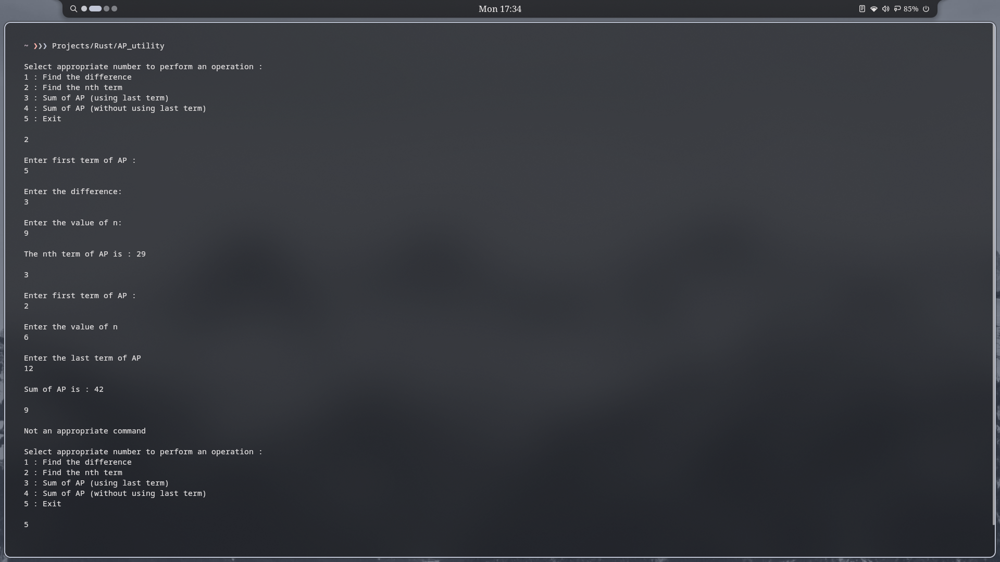

# Arithmetic Progression Utility
A simple program for Arithmetic Progression built in Rust.

## Features 
- Simple and Easy to use
- Uses textbook formulas for calculations
- CLI based
- Supports both methods for Sum of AP

## Preview

